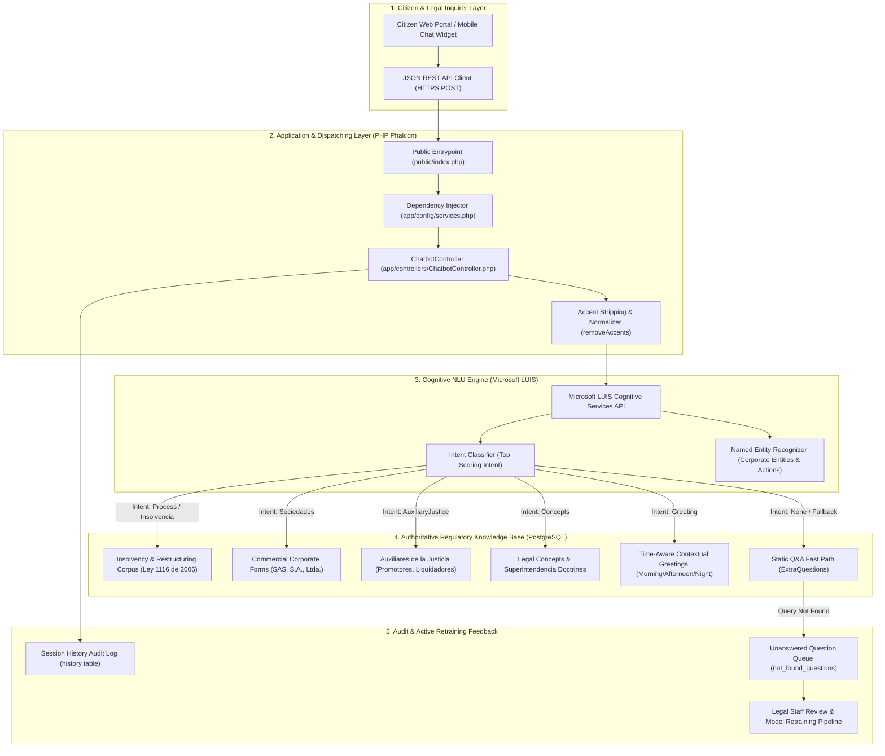
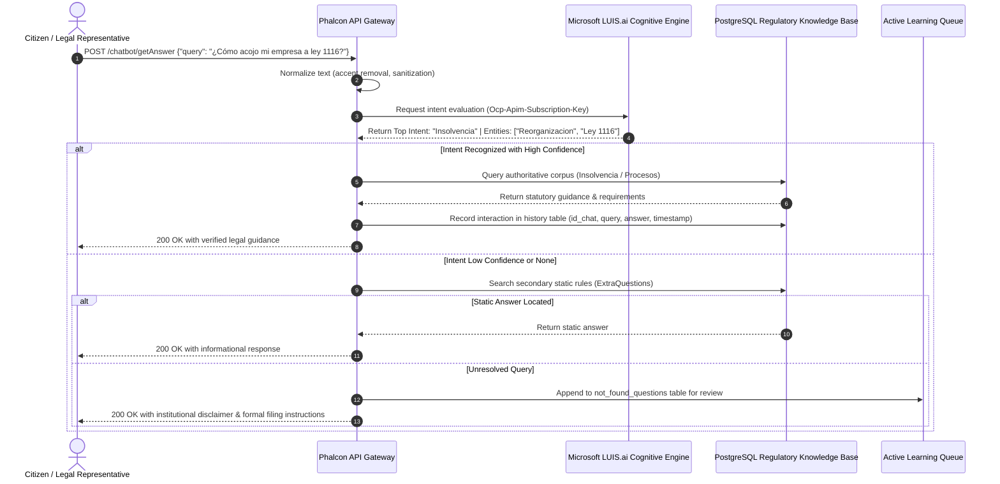

# Superintendencia de Sociedades: Conversational AI & Regulatory NLP Platform

[](https://cloud.google.com/)
[](https://azure.microsoft.com/)
[](https://phalcon.io/)
[](https://www.postgresql.org/)
[](https://www.supersociedades.gov.co/)
[](#quick-start-with-docker-compose)

Production-grade LegalTech conversational intelligence system and natural language understanding (NLP) platform engineered for the **Superintendencia de Sociedades**, the official national regulatory and oversight body for commercial corporations in Colombia.

The platform provides an automated citizen assistance and legal orientation channel that interprets natural language queries, classifies corporate regulatory intents, retrieves authoritative legal doctrines, guides inquiries regarding corporate restructuring under **Insolvency Law 1116 of 2006**, explains company incorporation (such as **SAS under Law 1258 of 2008**), details the regime of **Auxiliares de la Justicia** (promoters and liquidators), and orchestrates an active learning feedback loop to continuously retrain cognitive models.

---

## System Architecture

The solution operates as a high-throughput, cloud-native micro-service designed for deployment on **Google App Engine** and containerized environments. It couples an external cognitive language model with an internal high-speed relational and NoSQL legal knowledge base.



---

## Citizen Regulatory Query & Legal Reasoning Flow



---

## Regulatory Domain Coverage

The knowledge base covers the core supervisory, judicial, and doctrinal responsibilities of the Superintendencia de Sociedades:

| Regulatory Area | Governing Legal Framework | Entities & Intents Handled | Description & Scope |
| :--- | :--- | :--- | :--- |
| **Insolvency & Restructuring** | Ley 1116 de 2006, D. 560/2020 | `Insolvencia`, `Procesos`, `Reorganizacion` | Preserving viable enterprises through creditor agreements, pre-packaged reorganization validation, and orderly judicial liquidations. |
| **Corporate Forms & SAS** | Ley 1258 de 2008, Código de Comercio | `Sociedades`, `SAS`, `Constitucion`, `Capital` | Formation, capital subscription (authorized/subscribed/paid), board of directors, shareholder assemblies, and statutory reform protocols. |
| **Auxiliares de la Justicia** | Régimen Único de Auxiliares | `AuxiliaryJustice`, `Liquidadores`, `Promotores` | Public registration requirements, professional experience criteria, conflict of interest regimes, incompatibilities, and fee determination. |
| **Legal Concepts & Doctrine** | Ley 222 de 1995, Art. 200 C.Co. | `Concepts`, `Administradores`, `Dividendos` | Administrator civil liabilities, conflict of interest management, dividend distributions, inspection, and formal supervisory inquiries. |
| **Institutional Orientation** | Trámites & Sedes SuperSociedades | `Information`, `Consult`, `Greeting` | Physical and regional offices (Medellín, Cali, Barranquilla, Bucaramanga), filing hours, and document tracking (*Consulta de Radicados*). |

---

## Active Learning & Unsupervised Query Capture

A core design principle of this platform is its resilience against out-of-distribution queries:
1. When Microsoft LUIS returns a top-scoring intent of `None` or confidence falls below the acceptance threshold, the query enters a fallback evaluation against `ExtraQuestions`.
2. If no matching response exists, the query is automatically logged into the **`not_found_questions`** repository with precise timestamps.
3. Legal analysts and NLP engineers at the Superintendencia review this unhandled query queue periodically, adding training utterances to Microsoft LUIS and creating specialized static answers, creating a closed-loop retraining cycle.

---

## Repository Structure

```
gcp-luisAI-supersociedades-conversational-bot/
├── app/
│   ├── config/
│   │   ├── config.php                      # Dynamic environment configuration
│   │   ├── loader.php                      # PSR-4 / Phalcon autoloader
│   │   ├── services.php                    # DI service container (DB, session, pusher)
│   │   └── credentials.json.example        # Sanitized GCP service account template
│   ├── controllers/
│   │   ├── ChatbotController.php           # Core intent routing & NLP evaluator (599 lines)
│   │   └── ControllerBase.php              # Base controller, JSON formatter, and LUIS client
│   ├── library/
│   │   ├── HttpRequestCurl.php             # Optimized HTTP request dispatcher
│   │   └── constants/                      # Service constants and enums
│   └── models/
│       ├── AuxiliaryJustice.php            # Court auxiliaries legal repository
│       ├── Concepts.php                    # Superintendencia official doctrinal concepts
│       ├── Consult.php                     # Citizen case and filing lookups
│       ├── ExtraQuestions.php              # Static FAQ dictionary for rapid matching
│       ├── General.php                     # Institutional competencies & general queries
│       ├── Greeting.php                    # Time-conditioned dynamic greetings
│       ├── History.php                     # Full conversational audit trail per session
│       ├── Information.php                 # Headquarters, hours, and physical facilities
│       ├── Insolvencia.php                 # Restructuring & insolvency rules (Ley 1116)
│       ├── NotFoundQuestions.php           # Active learning unhandled questions queue
│       ├── Procesos.php                    # Judicial restructuring proceedings
│       ├── Request.php                     # Session request records
│       ├── Sociedades.php                  # Mercantile company structures (SAS, S.A.)
│       └── UserChat.php                    # End-user profile tracking
├── docker/
│   └── init.sql                            # Complete PostgreSQL schema & legal seeds
├── scripts/
│   └── test_chatbot.py                     # Python automated test and verification suite
├── public/
│   ├── index.php                           # Application HTTP entrypoint
│   └── .htaccess                           # URL rewriting configuration
├── datastore_index.yaml                    # Google Cloud Datastore index definitions
├── Dockerfile                              # Production Apache + PHP 7.4/8.x runtime
├── docker-compose.yml                      # Local full-stack development orchestration
├── composer.json                           # PHP dependencies & Web3 autoloading
└── .gitignore                              # Production ignore rules
```

---

## Technical Specifications

| Parameter | Specification |
| :--- | :--- |
| **Backend Language** | PHP 7.4 / 8.x (High-Performance Phalcon Framework Architecture) |
| **NLP Engine** | Microsoft LUIS.ai (Language Understanding Intelligent Service) |
| **Relational Database** | PostgreSQL 15 / MariaDB 10.6 |
| **Cloud Hosting** | Google Cloud Platform (Google App Engine + Cloud Datastore) |
| **Asynchronous Realtime** | Pusher Channels Integration |
| **Containerization** | Docker Engine & Docker Compose |
| **Text Preprocessing** | Diacritics stripping, case normalization, and intent slot filling |

---

## Quick Start with Docker Compose

### Prerequisites
- Docker Engine 20.10+
- Docker Compose v2.0+
- Python 3.8+ (for automated verification test suite)

### 1. Launch the Stack
```bash
# Clone the repository
git clone git@github.com-personal:KevinAndrey96/gcp-luisAI-supersociedades-conversational-bot.git
cd gcp-luisAI-supersociedades-conversational-bot

# Start PostgreSQL and the PHP application
docker compose up -d
```

### 2. Verify Database Health
```bash
docker compose ps
# The 'postgres' container will report healthy once init.sql executes
```

### 3. Run Automated Queries
```bash
python3 scripts/test_chatbot.py
```

### 4. Manual API Query via cURL
```bash
curl -X POST http://localhost:8098/chatbot/getAnswer \
  -H "Content-Type: application/json" \
  -d '{
    "query": "buenos dias como constituyo una sas",
    "id_chat": "session-unique-abc-123"
  }'
```

---

## Security & Sanitization Notice

This repository has been cleansed using `git-filter-repo`:
- Google Cloud Platform service account private keys (`credentials.json`) have been removed from commit history. A template is provided at `app/config/credentials.json.example`.
- Microsoft Cognitive Services LUIS subscription keys, Pusher secrets, and database passwords have been replaced with configurable environment variables.
- Vendor dependency bundles and compiled phar binaries were pruned to optimize repository footprint.

---

## License & Institutional Credits

Developed by **Kevin Andrey Herrera Silva** for the **Superintendencia de Sociedades de Colombia**. All rights to official regulatory content, statutory procedures, and corporate doctrines belong to the Colombian state and the Superintendencia de Sociedades.
